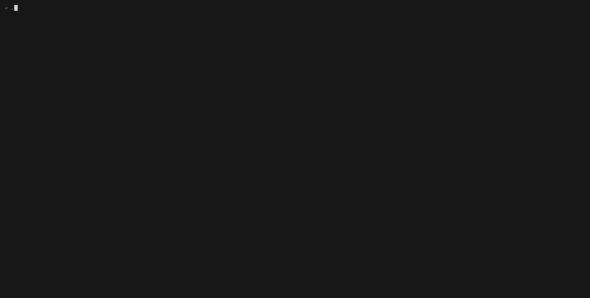

# readmarks - A terminal feed reader and bookmark manager in one program.

Built on [markix](https://codeberg.org/adsellor/markix).

- [Building](#building)
- [Running](#running)
- [Keys](#keys)
- [Command centre](#command-centre)
- [Files](#files)
- [Configuration](#configuration)
- [Installing a release binary](#installing-a-release-binary)
- [Installing with Nix](#installing-with-nix)
- [Home Manager](#home-manager)

## Building

Requires Zig 0.17.0-dev (see `minimum_zig_version` in `build.zig.zon`).

    zig build              # build
    zig build run          # build and run
    zig build test         # unit tests
    zig build check        # compile, test and check formatting
    zig build web          # wasm demo into zig-out/web

`-Dno-llvm` builds with Zig's own backend.

## Running

    readmarks                    open the reader
    readmarks import <file>...   add feeds from another tool's list
    readmarks help               usage

Import understands OPML, newsboat urls files, plain URL lists and readmarks
feed lists. The format is guessed unless `--format` says otherwise:

    readmarks import --format=newsboat ~/.newsboat/urls
    readmarks import subscriptions.opml

## Keys

`ctrl-u` switches between the reader and the bookmarks. `?` shows the full
sheet for whichever half you are in.

| Key | Action |
| --- | --- |
| `j` `k`, arrows | move the selection |
| `h` `l`, tab | move between panes |
| `g` `G`, home/end | first / last row |
| `ctrl-b` `ctrl-f` | move by a page |
| `:` `ctrl-p` | command centre |
| `/` | search the focused pane |
| `z` | zen mode |
| `1` `2` | all / shortlist |
| `enter` | open the selection |
| `o` | open it in the browser |
| `a` | add |
| `r` | refresh |
| `d` `d` | delete the selection |
| `ctrl-u` | reader / bookmarks |
| `?` | show the help sheet |
| `esc` | close, or clear the search |
| `q`, `ctrl-c` | quit |

Reader only:

| Key | Action |
| --- | --- |
| `v` | full-screen reader |
| `i` | open the article image |
| `m` | toggle read |
| `M` | mark everything shown read |
| `b` | save to bookmarks |
| `c` | collapse the pane |
| `R` | refresh every feed |
| `P` `P` | prune failed feeds |

Bookmarks only:

| Key | Action |
| --- | --- |
| `f` | toggle favourite |
| `v` | preview on its own |

## Command centre

`:` or `ctrl-p` opens it. Typing searches the collection. Typing `>` first
lists actions instead, so the two never mix:

    zig            articles, feeds and categories matching "zig"
    > refresh      the refresh actions

## Files

    ~/.config/readmarks/feeds            feed list, written by hand
    ~/.local/share/readmarks/            bookmarks and read marks
    ~/.cache/readmarks/                  article cache and images

The feed list is one feed per line:

    # comment
    https://ziglang.org/devlog/index.xml   category=Zig
    https://tigerbeetle.com/blog/feed.xml  category=Systems title="TigerBeetle"

`title=` pins the name so a refresh cannot rename the feed.

## Configuration

    READMARKS_THEME=terminal     inherit the terminal palette instead of the
                                 built-in one

## Installing a release binary

Tagged builds attach static binaries to the GitHub releases page. They have no
runtime dependencies, so download one, mark it executable and put it on your
path:

    curl -LO https://github.com/adsellor/readmarks/releases/latest/download/readmarks-linux-x86_64
    chmod +x readmarks-linux-x86_64
    mv readmarks-linux-x86_64 ~/.local/bin/readmarks

Four builds are published, all cross-compiled from the Linux runner:

    readmarks-linux-x86_64     static, glibc not required
    readmarks-linux-aarch64    static, glibc not required
    readmarks-macos-x86_64     Intel Macs
    readmarks-macos-aarch64    Apple Silicon

`SHA256SUMS` is published alongside them:

    sha256sum -c SHA256SUMS --ignore-missing

The macOS binaries are unsigned, so Gatekeeper will refuse them on first run.
Clear the quarantine attribute after downloading:

    xattr -d com.apple.quarantine readmarks-macos-aarch64

## Installing with Nix

    nix run github:adsellor/readmarks
    nix profile install github:adsellor/readmarks

From a clone:

    nix build            # result/bin/readmarks
    nix develop          # shell with the pinned Zig
    nix run

The flake exposes `default`, which picks Zig's own backend on x86_64 Linux and
LLVM elsewhere, plus `readmarks-fast` and `readmarks-llvm` to force one or the
other. `readmarks-bin` installs the release binary instead of compiling, and
appears once the hashes in `flake.nix` are filled in for a tag:

    nix store prefetch-file --hash-type sha256 \
      https://github.com/adsellor/readmarks/releases/download/v0.2.0/readmarks-linux-x86_64

## Home Manager

Add the flake as an input:

    inputs.readmarks.url = "github:adsellor/readmarks";

Then install it in your home configuration:

    { inputs, pkgs, ... }:
    {
      home.packages = [
        inputs.readmarks.packages.${pkgs.system}.default
      ];
    }

Swap `default` for `readmarks-bin` to install the prebuilt binary and skip the
toolchain entirely, which is the faster option on a machine that has no reason
to hold a Zig build:

    home.packages = [
      inputs.readmarks.packages.${pkgs.system}.readmarks-bin
    ];

The feed list is configuration, so it can live in the same place:

    home.file.".config/readmarks/feeds".text = ''
      https://ziglang.org/devlog/index.xml   category=Zig
      https://tigerbeetle.com/blog/feed.xml  category=Systems
    '';

Managing that file with Home Manager makes it read only, which is what you want
if the list is declared here rather than edited by hand.

